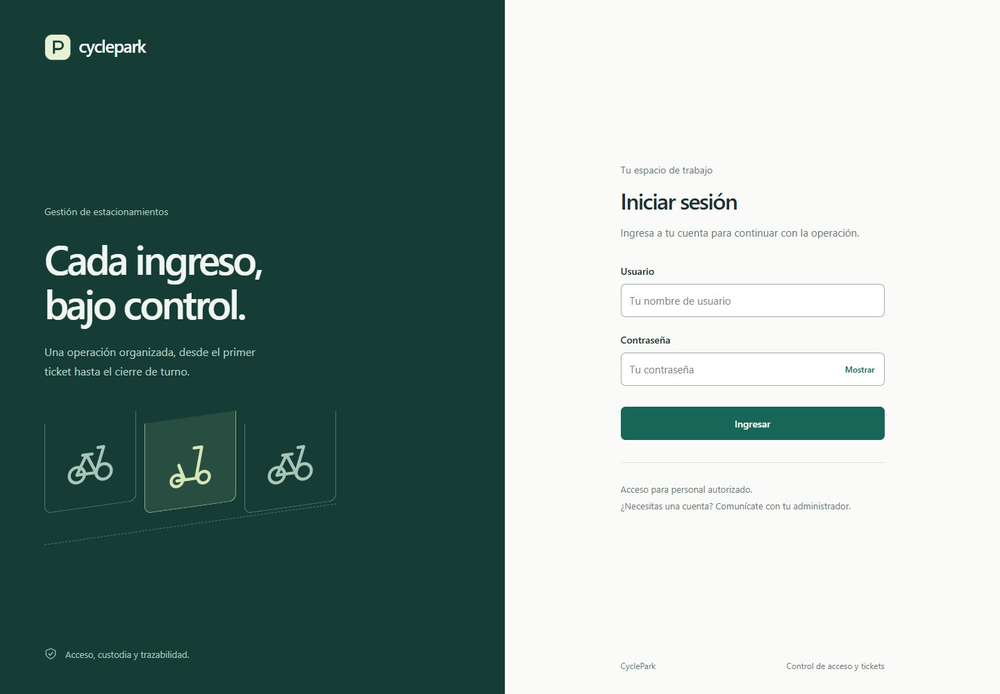
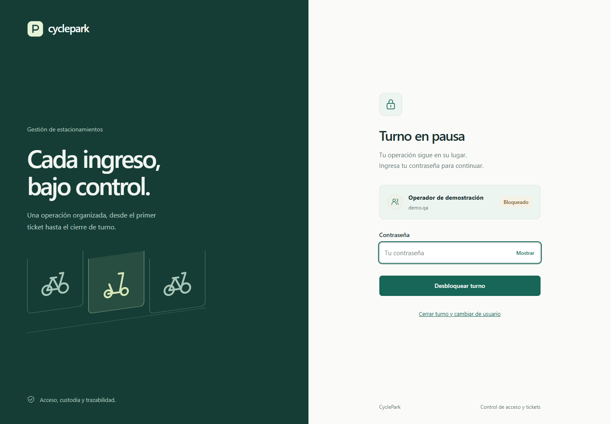
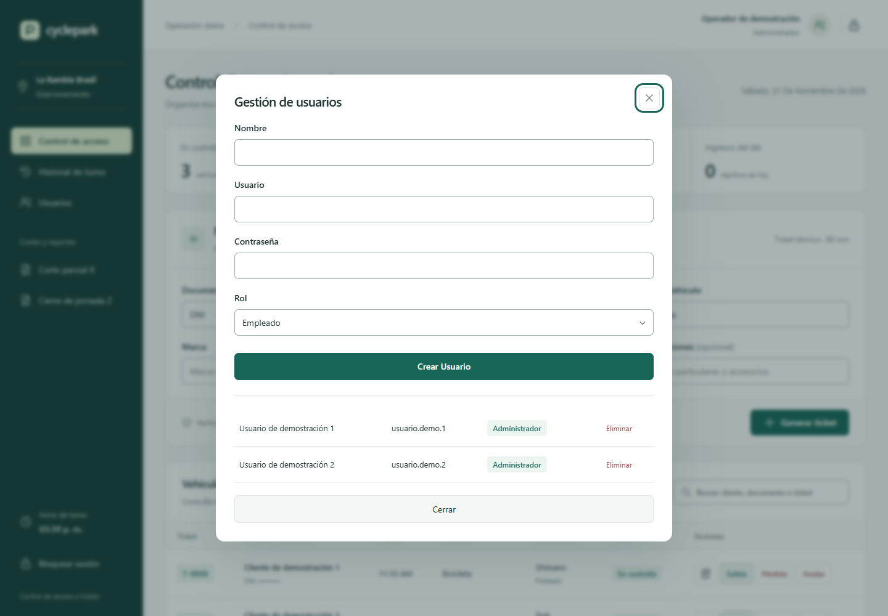
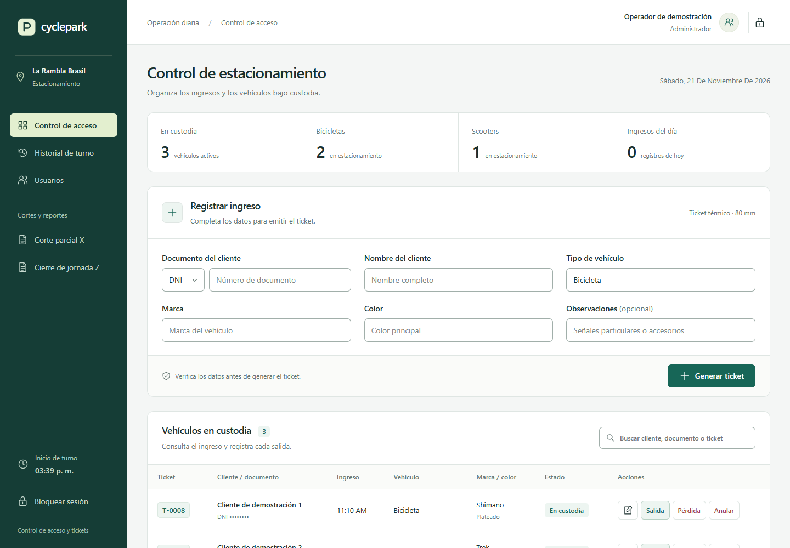
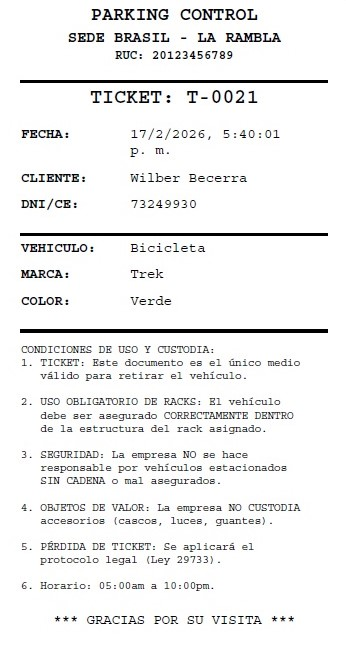
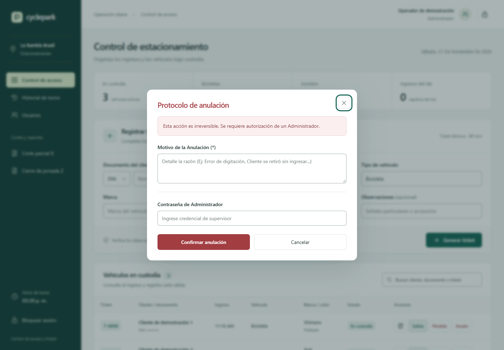
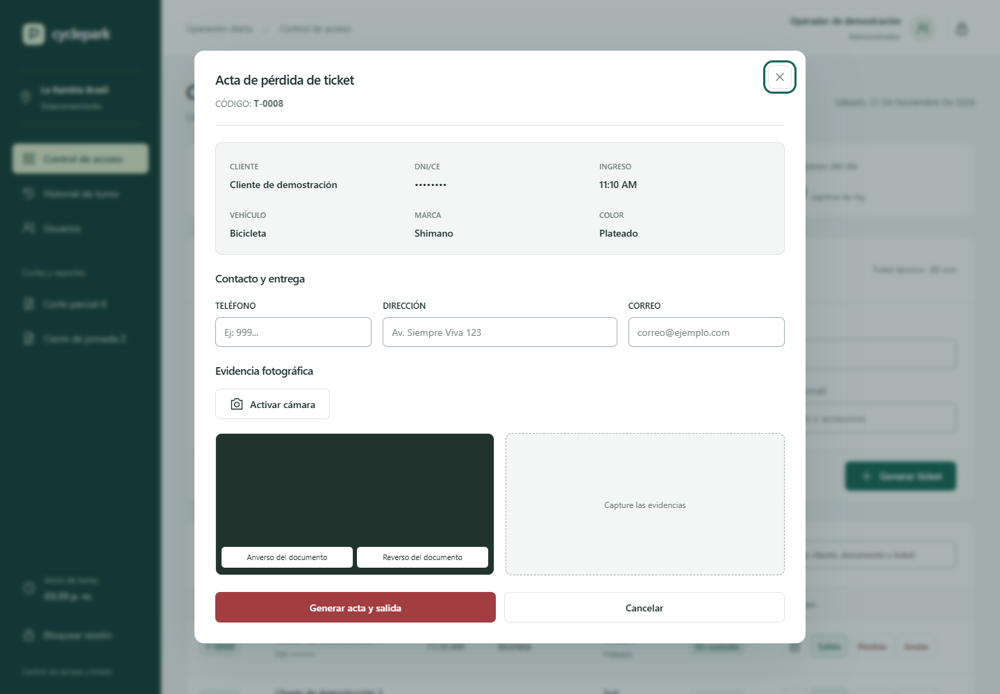

# CyclePark — Sistema de Control de Acceso e Inventario de Tickets


**CyclePark** es una aplicación web diseñada para la gestión operativa, emisión de tickets térmicos y control de seguridad física en estacionamientos de vehículos menores. Digitaliza el flujo completo de ingreso, custodia, cierre de caja y auditoría bajo una arquitectura en 3 capas, garantizando trazabilidad en cada transacción y cumplimiento de protocolos legales de custodia.

---

## Contexto Operativo

El sistema fue concebido a partir de necesidades reales en la operación de estacionamientos de alto tránsito (referencia operativa: sede *La Rambla Brasil*), resolviendo tres cuellos de botella críticos:

*   **Ingreso de alta velocidad (Fast-Track):** Registro ágil y emisión inmediata de tickets físicos con numeración correlativa única.
*   **Control patrimonial:** Validación visual mediante captura fotográfica por cámara web para mitigar riesgos de suplantación al momento del retiro.
*   **Cumplimiento normativo:** Protocolo formal de emisión de actas ante pérdida de ticket alineado a la **Ley N° 29733** (Ley de Protección de Datos Personales).

---

## Funcionalidades Principales

*   **Motor de Impresión Térmica (80 mm):** Generación dinámica de comprobantes en PDF optimizados para impresoras POS, ajustando el alto del documento según el contenido y las cláusulas legales.
*   **Autenticación y Control de Acceso (RBAC):** Gestión diferenciada por roles (operador y administrador), protección de credenciales con **Bcrypt** y soporte de compatibilidad controlada para migración progresiva desde credenciales heredadas sin detener la operación.
*   **Continuidad de Turno:** Bloqueo de interfaz y persistencia del estado operativo para proteger la sesión del cajero ante pausas o recargas accidentales.
*   **Anulación y Auditoría:** Protocolo de anulación con verificación administrativa, captura de evidencia fotográfica para incidencias y registro de eventos.
*   **Reportes Financieros Automatizados:** Generación de cierres de caja (**Corte X / Corte Z**) en formato PDF corporativo y exportación de tablas estilizadas a Excel para auditoría.

---

## Stack Tecnológico

| Capa | Tecnologías y Librerías |
| :--- | :--- |
| **Backend** | Node.js (v18+), Express |
| **Base de Datos** | Microsoft SQL Server (Transact-SQL), driver `mssql` |
| **Frontend** | HTML5, CSS3 (Flexbox / Grid), JavaScript ES6+ (Vanilla) |
| **Arquitectura** | Patrón MVC / 3 Capas (Presentación, Lógica de Negocio/API, Datos) |
| **Seguridad** | `bcryptjs` (hashing de contraseñas), control de acceso por roles (RBAC) |
| **Reportería y Documentos** | `jspdf`, `jspdf-autotable` (PDF y tickets térmicos), `xlsx-js-style` (Excel) |

---

## Capturas del Sistema

### Seguridad y Control de Acceso

| Inicio de Sesión | Bloqueo de Turno | Gestión de Usuarios (RBAC) |
| :---: | :---: | :---: |
|  |  |  |
| *Validación de credenciales por rol* | *Bloqueo de interfaz con persistencia de turno* | *Módulo exclusivo de administración* |

### Operación Diaria y Emisión POS

| Panel Principal | Ticket Térmico (80 mm) | Protocolo de Anulación |
| :---: | :---: | :---: |
|  |  |  |
| *Control de ingresos y aforo en tiempo real* | *Generación dinámica en PDF con cláusulas legales* | *Flujo de validación administrativa* |

### Auditoría y Reportería

| Acta de Pérdida de Ticket | Cierre de Caja (PDF) | Exportación Financiera (Excel) |
| :---: | :---: | :---: |
|  |  |  |
| *Captura fotográfica y acta formal (Ley N° 29733)* | *Reportes operativos Corte X / Z* | *Exportación estructurada para auditoría* |

> **Nota:** Las capturas reflejan el flujo operativo de la sede *La Rambla Brasil*. Los datos personales de las vistas de interfaz están anonimizados para su publicación.

---

## Estructura del Proyecto

```text
cycle-parking-system/
├── public/                     # Capa de Presentación (Frontend)
│   ├── assets/                 # Logos, capturas y recursos estáticos
│   ├── css/                    # Hojas de estilo responsivas
│   ├── js/                     # Lógica de cliente (Fetch API, manipulación DOM)
│   └── views/                  # Vistas HTML (Login, Dashboard y módulos)
│
├── src/                        # Capa de Lógica de Negocio y Datos (Backend)
│   ├── config/                 # Configuración de conexión a Base de Datos
│   │   └── db.js               # Pool de conexión a SQL Server
│   ├── routes/                 # Definición de endpoints REST
│   │   ├── auth.routes.js      # Autenticación, sesiones y usuarios
│   │   ├── client.routes.js    # Registro y consulta de clientes
│   │   └── ticket.routes.js    # Ingresos, salidas, anulaciones y reportes
│   └── index.js                # Punto de entrada del servidor Express
│
├── .env                        # Variables de entorno (no versionado)
└── package.json                # Dependencias y scripts de ejecución
```

---

## Instalación y Ejecución Local

### Prerrequisitos

*   Node.js v18 o superior.
*   Instancia activa de Microsoft SQL Server.

### Pasos de configuración

1. **Clonar el repositorio:**

```bash
git clone https://github.com/wilberbecerra/cycle-parking-system.git
cd cycle-parking-system
```

2. **Instalar dependencias:**

```bash
npm install
```

3. **Configurar variables de entorno:**

Crea un archivo `.env` en la raíz del proyecto con las credenciales de tu instancia local de SQL Server:

```env
PORT=3000
DB_USER=tu_usuario
DB_PASSWORD=tu_password
DB_SERVER=localhost
DB_PORT=1435
DB_DATABASE=DB_ParkingControl
```

En Windows también puedes usar tu identidad de Windows existente con `DB_TRUSTED_CONNECTION=true`, ODBC Driver 17 y el controlador opcional `msnodesqlv8` instalado (Node.js 22 o superior para ese modo). No requiere crear un login SQL ni guardar una contraseña de conexión.

La consulta externa de identidad es opcional: configura `IDENTITY_API_TOKEN` únicamente en tu archivo `.env`. Si no está configurada, se consultan los clientes locales y el nombre puede completarse manualmente.

4. **Iniciar el servidor:**

```bash
npm start
```


Abre [CyclePark](http://localhost:3000/). Los accesos existentes se conservan; no se crean ni restablecen usuarios automáticamente.

### Verificación

```bash
npm test
```

Las pruebas utilizan un repositorio simulado y credenciales exclusivas de prueba. No modifican la base de datos operativa. Se verifican vistas y recursos, autenticación, identificadores de usuario, consultas, incidencias y escape de datos al generar HTML. PDF y Excel se generan en el navegador con sus librerías locales.
